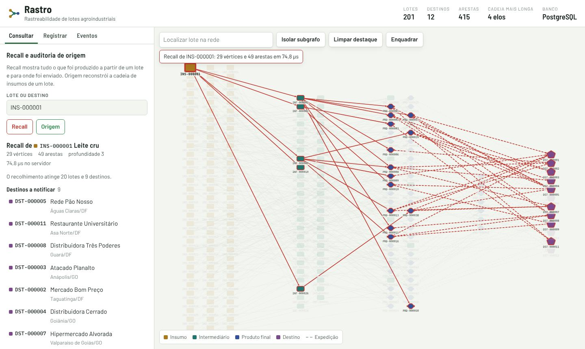
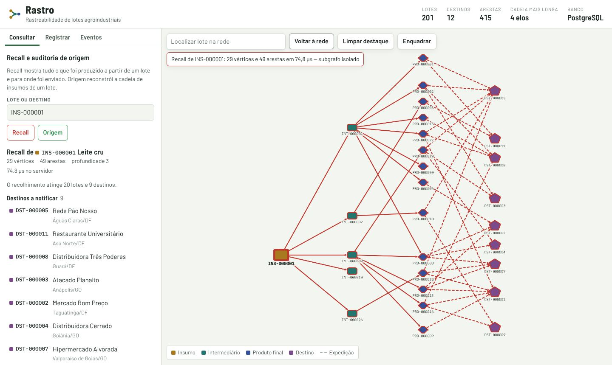
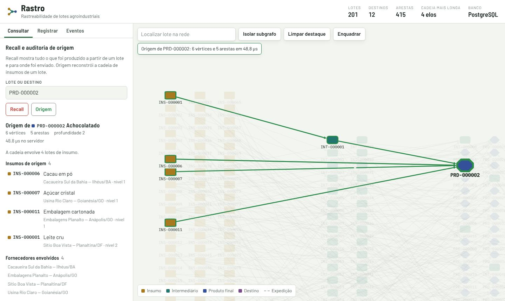
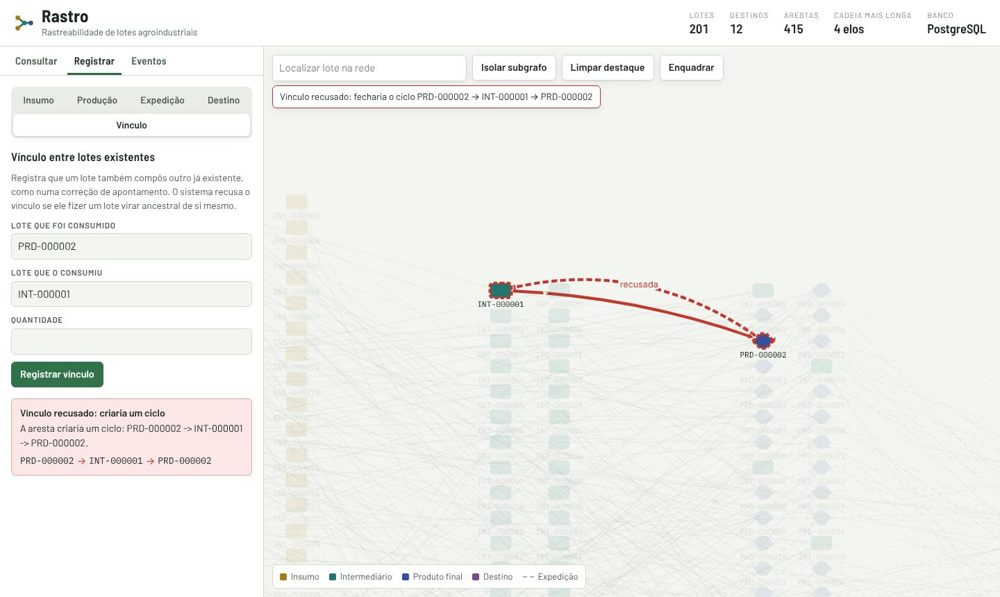

# Manual de uso

Pacote 1.6.1 da EAP. Este manual descreve a interface web. Para instalar e subir o sistema, veja o [README](../README.md).

## Visão geral da tela

- **Topo**: indicadores da base (lotes, destinos, arestas, cadeia mais longa) e o banco em uso.
- **Painel lateral**: abas *Consultar*, *Registrar* e *Eventos*.
- **Rede**: o grafo da cadeia produtiva. Cada estágio da cadeia é um bloco, da esquerda para a direita: insumos, intermediários, produtos finais e, por último, os destinos. Dentro de cada bloco os lotes seguem a ordem de registro. Arestas tracejadas são expedições.

| Cor e forma | Tipo |
|---|---|
| Barril dourado | Insumo |
| Retângulo verde-água | Intermediário |
| Etiqueta azul | Produto final |
| Pentágono roxo | Destino |

Use a roda do mouse (ou pinça no celular) para aproximar; os códigos dos lotes aparecem conforme o zoom aumenta. **Enquadrar** volta a mostrar a rede inteira. Clicar em um vértice abre o painel de detalhe com quantidade, fornecedor ou cidade, as arestas de entrada e de saída e atalhos para consultas.

Quando a base tem mais de 1 500 vértices, a rede mostra os destinos e os lotes mais recentes, e uma faixa avisa quantos estão visíveis. Consultas, a busca e o botão *Vizinhança* abrem qualquer parte do grafo.

## Recall

Use quando um lote foi comprometido (contaminação, falha de processo) e é preciso saber o que recolher e quem avisar.

1. Na aba **Consultar**, digite o código do lote (o campo sugere lotes pelo código, produto, fornecedor ou cidade) e clique em **Recall**. Também é possível clicar no lote na rede e usar o botão *Recall* do painel de detalhe.
2. A rede apaga tudo o que não foi afetado e destaca em vermelho o caminho do lote até os destinos.
3. O painel lista os **destinos a notificar** (com cidade), os **produtos finais a recolher**, os intermediários afetados e quanto tempo a consulta levou no servidor.
4. **Isolar subgrafo** redesenha só a parte afetada, em camadas, para leitura. **Voltar à rede** retorna à visão completa e **Limpar destaque** remove a seleção.

## Auditoria de origem

Use para responder de onde veio um produto, por exemplo numa auditoria ou reclamação de cliente.

1. Digite o código do lote e clique em **Origem**.
2. A rede destaca em verde toda a cadeia que compôs o lote.
3. O painel lista os **insumos de origem** com o fornecedor de cada um, os **fornecedores envolvidos** e os intermediários do caminho.

Para um destino, o botão do painel de detalhe se chama *O que recebeu*: ele mostra todos os lotes enviados ao cliente e suas origens.

## Registrar

Na aba **Registrar**, escolha o tipo de registro:

| Registro | Quando usar | O que acontece no grafo |
|---|---|---|
| **Insumo** | Chegada de um lote de matéria-prima | Novo vértice de insumo |
| **Produção** | Uma transformação: lotes de entrada viram um novo lote | Novo vértice e uma aresta de cada entrada até ele |
| **Expedição** | Envio de um lote a um cliente | Aresta tracejada do lote até o destino |
| **Destino** | Novo cliente ou ponto de venda | Novo vértice de destino |
| **Vínculo** | Correção: um lote também compôs outro já existente | Nova aresta entre lotes existentes, se não criar ciclo |

O código do lote é gerado automaticamente (`INS-000123`, `PRD-000045`…) quando o campo fica em branco. Na produção, **+ Adicionar entrada** inclui mais lotes de entrada. O botão *Usar em produção*, no painel de detalhe, adiciona o lote selecionado às entradas.

Depois de registrar, a rede é atualizada e o novo vértice fica selecionado.

### Quando o sistema recusa um registro

- **Ciclo**: um vínculo que faria um lote virar ingrediente de si mesmo é recusado. A mensagem mostra o ciclo e a rede desenha a aresta recusada em vermelho tracejado.
- **Regra do domínio**: insumos não são produzidos a partir de outros lotes, destinos não enviam lotes e uma expedição precisa ter um destino como alvo.
- **Duplicidade**: o mesmo código de lote ou a mesma ligação não podem ser registrados duas vezes.

Nenhum registro recusado deixa dados parciais: o evento, o lote e as arestas são gravados juntos ou não são gravados.

## Eventos

A aba **Eventos** lista os últimos registros (recebimento, produção, expedição, ajuste) com data, descrição e os lotes ou ligações que cada um criou. Clique em um código para localizá-lo na rede.
