# Modelagem de dados e do grafo

## 1. O grafo

O Rastro representa a cadeia produtiva como um grafo dirigido G = (V, E).

**Vértices**

| Tipo | Código gerado | Exemplo | Papel |
|---|---|---|---|
| `insumo` | `INS-000001` | Leite cru, Sal refinado, Embalagem plástica | Abre a cadeia; nunca tem arestas de entrada |
| `intermediario` | `INT-000001` | Leite pasteurizado, Farinha de trigo | Produzido a partir de outros lotes e consumido por outros |
| `produto_final` | `PRD-000001` | Queijo minas frescal, Pão de forma | Produzido e expedido |
| `destino` | `DST-000001` | Supermercado Central — Asa Norte/DF | Cliente que recebe lotes; nunca origina arestas |

**Arestas**

| Tipo | Sentido | Criada por |
|---|---|---|
| `composicao` | lote de entrada → lote produzido | evento de produção ou vínculo manual |
| `expedicao` | lote → destino | evento de expedição |

O tipo da aresta é deduzido do vértice de destino: toda aresta que chega a um destino é expedição; as demais são composição.

**Invariantes** (validadas pelo motor a cada inserção)

1. O grafo é acíclico: nenhum lote é ancestral de si mesmo.
2. Não há laços nem arestas repetidas.
3. Insumos não recebem arestas; destinos não originam arestas.
4. A relação é N:N: um lote de insumo compõe vários produtos e um produto consome vários lotes.

O grafo é **dinâmico**: começa vazio e cresce a cada recebimento, produção e expedição registrados pela interface ou pela API.

## 2. Estrutura em memória

`GrafoRastro` guarda duas listas de adjacência implementadas como dicionários aninhados:

- `_saida[u][v] = aresta` para percorrer no sentido da produção (recall);
- `_entrada[v][u] = aresta` para percorrer no sentido contrário (origem).

Inserir e remover vértices e arestas custa O(1), e cada travessia visita cada vértice e aresta alcançáveis uma única vez.

## 3. Algoritmos

| Operação | Algoritmo | Custo |
|---|---|---|
| Recall | BFS pelas arestas de saída a partir do lote comprometido; guarda o nível de cada vértice | O(V' + E') no subgrafo alcançado |
| Auditoria de origem | BFS pelas arestas de entrada (travessia reversa) | O(V' + E') |
| Aciclicidade na inserção u → v | Ordem topológica dinâmica de Pearce & Kelly | O(1) se ord(u) < ord(v); senão, proporcional à região afetada |
| Aciclicidade (referência) | DFS a partir de v procurando u | O(V + E) no pior caso |
| Reconstrução a partir do banco | Inserção direta + ordenação topológica de Kahn | O(V + E) |
| Cadeia mais longa | Programação dinâmica sobre a ordem topológica | O(V + E) |
| Vizinhança (visualização) | BFS ignorando o sentido, limitada ao raio | O(V' + E') |

### 3.1 Verificação de aciclicidade com ordem topológica dinâmica

O motor mantém um índice `ord(x)` para cada vértice, de modo que toda aresta u → v respeite `ord(u) < ord(v)`. Um vértice novo recebe o maior índice, o que sempre é válido porque ele ainda não tem arestas.

Ao inserir u → v:

1. Se `ord(u) < ord(v)`, a aresta respeita a ordem atual e não pode fechar ciclo. Esse é o caso comum, porque numa produção o lote de saída é novo e tem o maior índice.
2. Senão, só podem estar num caminho de v até u os vértices com índice entre `ord(v)` e `ord(u)`. O motor faz uma busca para frente a partir de v restrita a essa faixa. Se encontrar u, há ciclo, e o caminho encontrado é devolvido na mensagem de erro.
3. Se não houver ciclo, uma busca para trás a partir de u (na mesma faixa) encontra os vértices que precisam vir antes. Os índices já ocupados pelos dois conjuntos são redistribuídos: primeiro os que chegam em u, depois os que saem de v.

Remover arestas nunca invalida uma ordem topológica, por isso desfazer uma operação é simples.

A estratégia DFS continua disponível (`GrafoRastro(EstrategiaCiclo.BUSCA_PROFUNDIDADE)`). Um teste de propriedade confere que as duas aceitam e rejeitam exatamente as mesmas arestas que uma checagem de alcançabilidade por força bruta, e que a ordem mantida continua topológica após centenas de inserções aleatórias.

### 3.2 Por que não fazer as travessias em SQL

Uma consulta de recall direto no banco exige uma CTE recursiva (`WITH RECURSIVE`), executada a cada pedido. O repositório implementa essa versão (`descendentes_sql`) e os testes confirmam que ela devolve o mesmo conjunto que a BFS. Nos testes de carga, a CTE leva de 1 a 1,7 ms por consulta no PostgreSQL contra cerca de 0,01 ms da BFS em memória (ver [testes-de-carga.md](testes-de-carga.md)).

## 4. Persistência: edge list

```mermaid
erDiagram
  eventos ||--o{ vertices : "cria"
  eventos ||--o{ arestas : "cria"
  vertices ||--o{ arestas : "origem"
  vertices ||--o{ arestas : "destino"

  eventos {
    int id PK
    varchar tipo "cadastro | producao | expedicao | ajuste"
    timestamptz ocorrido_em
    text descricao
    varchar responsavel
  }
  vertices {
    varchar id PK "INS-000001"
    varchar tipo "insumo | intermediario | produto_final | destino"
    varchar nome
    float quantidade
    varchar unidade
    jsonb atributos "fornecedor, cidade..."
    timestamptz criado_em
    int evento_id FK
  }
  arestas {
    varchar origem PK "FK vertices"
    varchar destino PK "FK vertices"
    varchar tipo "composicao | expedicao"
    float quantidade
    int evento_id FK
  }
```

- `arestas` é a lista de arestas (edge list) propriamente dita. A chave primária `(origem, destino)` impede arestas repetidas e serve à travessia descendente; o índice `ix_arestas_destino` serve à ascendente.
- Restrições `CHECK` garantem os tipos válidos e a ausência de laços (`origem <> destino`). A aciclicidade, que envolve caminhos, é garantida pelo motor.
- `eventos` é a trilha de auditoria: cada vértice e cada aresta apontam para o evento que os criou.
- `atributos` é JSON (JSONB no PostgreSQL) para dados que variam por tipo: fornecedor de um insumo, cidade de um destino.

## 5. Consistência entre memória e banco

Toda escrita passa por `ServicoRastro`, que:

1. adquire um lock (as escritas são serializadas);
2. abre uma transação no banco e grava o evento;
3. aplica a mudança no grafo em memória, que valida regras e aciclicidade, e grava as linhas correspondentes;
4. faz o commit.

Se qualquer passo falhar, inclusive o commit, a transação é desfeita e as alterações em memória são revertidas na ordem inversa. Um teste simula a queda do banco no meio de uma produção e confirma que nada sobra em memória nem no banco.

Na inicialização, `Repositorio.carregar_grafo` lê as duas tabelas e reconstrói o grafo. Em vez de checar ciclo aresta por aresta, liga todas as arestas e valida o grafo inteiro com uma única ordenação de Kahn, que também inicializa a ordem topológica dinâmica. Com 100 mil lotes e 225 mil arestas, a reconstrução leva menos de 1 segundo.

## 6. Base sintética

`rastro/sintetico.py` simula a operação de uma agroindústria em dias. A cada dia ela recebe lotes de 12 matérias-primas, produz 8 intermediários e 7 produtos finais seguindo receitas fixas (o iogurte de morango leva leite pasteurizado, polpa de morango e embalagem; a polpa leva morango e açúcar) e expede cada produto final para 1 a 3 clientes. Cada lote produzido consome lotes recentes de cada matéria-prima, o que reproduz a relação N:N sem ligar tudo a tudo: com 100 mil lotes, um recall típico alcança cerca de 10 vértices. A semente torna a base reproduzível. Fornecedores e clientes são fictícios.
